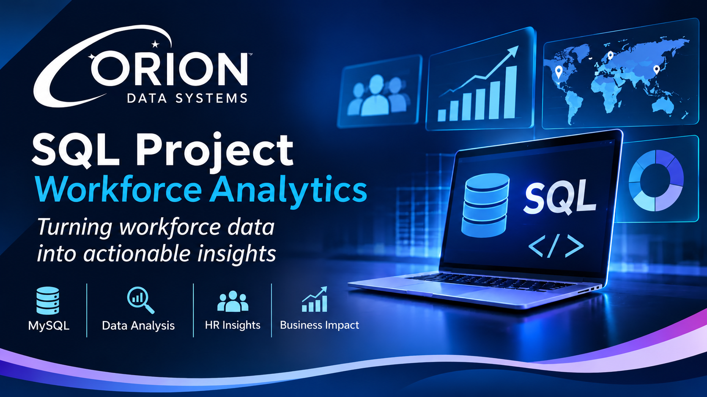

# Orion Data Systems – Workforce Analytics Report(Jan - Nov 2026)

 

## Executive Summary

This project analysed employee and workforce data for Orion Data Systems using SQL in MySQL Workbench. The analysis focused on workforce distribution, salary patterns, employee rankings, departmental leadership, job roles, and workforce gaps.

The results revealed that the workforce is concentrated in a few departments, with Shipping and Sales accounting for the largest employee groups. Salary analysis showed that 49 employees fall within the low salary band, 43 within the medium band, and 15 within the high salary band. The analysis also identified the highest-paying job roles, departments with the lowest average salaries, and countries with the highest total salary costs.
These findings provide useful insights into workforce structure, compensation distribution, and areas that may require further HR review.
The analysis covers ten business questions using SQL queries, including aggregate functions, joins, subqueries, Common Table Expressions (CTEs), and window functions.

## Business Context

Understanding workforce structure and salary distribution is important for effective human resource management. Organisations need to know how employees are distributed across departments, how compensation differs across roles, and whether staffing levels are balanced.
Orion Data Systems required a workforce analysis to examine employee distribution, salary patterns, departmental performance, and job-role compensation.
SQL was used to query, group, filter, rank, and aggregate the employee data to answer relevant workforce and business questions.

## Objectives

### The objectives of this analysis were to:

- Examine employee distribution across departments.
- Compare salary levels across departments.
- Classify employees into salary bands.
- Identify departments with the lowest average salaries.
- Identify employees earning above the overall average salary.
- Analyse department leadership and employee counts.
- Identify job titles with average salaries above 12,000.
- Rank employees by salary within their departments.
- Compare total salary costs across countries.
- Identify job roles without assigned employees.

  ## Key Findings 

### The analysis investigates the following areas:

- Departments with the highest and lowest employee headcounts.
- Departments with the highest and lowest average salaries.
- Distribution of employees across low, medium, and high salary bands.
- Employees earning above the company-wide average salary.
- Job roles with average salaries above 12,000.
- Job roles without assigned employees.
- Employee salary rankings within departments.
- Total salary expenditure across countries.

## Data Cleaning and Transformation

MySQL was used to organise and analyse the supplied datasets.

### The preparation and analysis process included:

- Creating a dedicated database schema named "capstone".
- Working with four related workforce tables.
- Using table relationships and identifiers to connect employee, department, job, and country information.
- Handling NULL values when identifying job roles without assigned employees.
- Applying aggregate functions to calculate employee counts, average salaries, and total salary expenditure.
- Using CASE statements to classify employees into salary categories.
- Using CTEs and window functions to structure more advanced analysis.

## Detailed Findings & AnalysisData Analysis and Key Findings

### Workforce Distribution

The workforce distribution analysis showed that employee numbers are concentrated in a few departments.
The largest employee groups were:
- Department 50: 45 employees
- Department 80: 34 employees
- Department 100: 6 employees
- Department 30: 6 employees
- Department 60: 5 employees

Department 50 had the highest employee count, followed by Department 80.

Business Insight: The concentration of employees in these departments suggests that they play significant roles in the organisation's operations. Workforce planning should consider whether staffing levels are appropriate for departmental responsibilities.

4.2 Salary Band Analysis

Employees were classified into salary bands using SQL CASE statements.

Salary Band| Number of Employees
Low| 49
Medium| 43
High| 15

The low salary band contained the largest number of employees, while the high salary band contained the fewest.

Business Insight: The salary distribution indicates that a substantial proportion of employees fall within the lower salary category. Management may review compensation structures, job levels, and opportunities for salary progression.

4.3 Department Salary Analysis

The analysis identified the three departments with the lowest average salaries.

Department ID| Average Salary
50| 3,475.56
30| 4,150.00
10| 4,400.00

Department 50 recorded the lowest average salary among the departments returned by the query.

Business Insight: Departments with lower average salaries may require further examination of job roles, employee seniority, and compensation policies. A low average salary does not automatically indicate unfair pay, but it can help identify areas for review.

4.4 High-Earning Employees

A subquery was used to identify employees whose salaries were greater than the overall average salary.

The results included employees such as:

- Steven King – 24,000
- Neena Kochhar – 17,000
- Lex De Haan – 17,000
- John Russell – 14,000
- Karen Partners – 13,500

The analysis also returned other employees whose salaries exceeded the calculated average.

Business Insight: Identifying employees above the average salary helps reveal the organisation's higher-paid workforce and supports compensation comparisons across roles and departments.

4.5 Department Leadership Analysis

The department leadership query examined department names, manager names, and employee counts.

Key results included:

Department| Manager| Employee Count
Shipping| Michael Johnson| 45
Sales| Sophia Martinez| 34
Finance| David Jacobs| 6
Purchasing| Rebecca Chen| 6
IT| Cynthia Morrison| 5
Executive| Anthony Rodriguez| 3

Shipping and Sales had the largest employee counts among the departments displayed.

Business Insight: Department-level employee counts provide useful information for understanding managerial responsibilities and identifying departments that may require additional workforce planning.

4.6 Job Role Salary Analysis

The job role analysis identified job titles with an average salary greater than 12,000.

Job Title| Average Salary
President| 24,000
Administration Vice President| 17,000
Marketing Manager| 13,000
Sales Manager| 12,200

President had the highest average salary among the job titles returned.

Business Insight: The results show that senior leadership and managerial roles have higher average compensation. This information can support job-level salary comparisons and compensation planning.

4.7 Employee Salary Ranking

The analysis used the SQL ROW_NUMBER() window function to rank employees by salary within their departments.

The highest salaries visible in the results included:

- Steven King – 24,000
- Neena Kochhar – 17,000
- Lex De Haan – 17,000
- John Russell – 14,000
- Karen Partners – 13,500

Business Insight: Employee ranking provides a structured way to compare compensation within departments and identify employees occupying higher salary positions.

4.8 Country-Level Workforce Analysis

The country-level analysis used a LEFT JOIN to examine the number of distinct departments represented in each country.

The results showed that Australia had 4 departments, while Belgium, Brazil, Canada, China, and Egypt each had 3 departments in the displayed results.

Business Insight: Comparing departmental presence across countries helps provide an overview of the organisation's geographical workforce structure.

4.9 Country Salary Cost Analysis

The country salary cost query aggregated employee salaries by country and sorted the results from highest to lowest.

Country| Total Salary Cost
Switzerland| 75,100
Italy| 52,100
Israel| 45,200
Argentina| 43,600
China| 42,400
Egypt| 41,600
Brazil| 38,000
Japan| 33,600
Belgium| 33,600
India| 32,800
United States| 31,600
Kuwait| 25,500

Switzerland recorded the highest total salary cost among the countries shown, while Kuwait recorded the lowest.

Business Insight: Country-level salary costs can help management understand how payroll expenditure is distributed geographically. These totals should be interpreted alongside employee counts because a higher total salary cost may reflect a larger workforce or higher average compensation.

4.10 Workforce Gap Analysis

A RIGHT JOIN was used to identify job records that did not have a matching employee record.

The result grid returned no records.

Business Insight: Based on this query, no job records without a matching employee were identified in the result. This suggests that the job records examined were associated with employee records in the dataset.

## Recommendations

### Based on the findings, the following recommendations are proposed:

- **Review workforce concentration:** Examine staffing levels in Departments 50 and 80 to ensure that employee distribution supports operational needs.
- **Review salary distribution:** Investigate the large number of employees in the low salary band and assess whether compensation aligns with job responsibilities and experience.
- **Evaluate departmental compensation:** Review the departments with the lowest average salaries to understand differences in job composition and pay structure.
- **Support salary benchmarking:** Use the job-role salary results to compare compensation across leadership and managerial positions.
- **Strengthen workforce planning:** Use departmental employee counts and country-level workforce information to support staffing and resource allocation decisions.
- **Monitor payroll expenditure:** Review country-level salary costs alongside employee counts to understand geographical differences in payroll spending.
- **Maintain workforce records:** Continue checking employee and job records to identify unmatched or incomplete workforce information.

## Tools Used

**MySQL:** Used for querying, analysing, and extracting insights from the workforce database.
**MySQL Workbench:** Used as the database management and SQL development environment.
**SQL Techniques:** Used for data retrieval, aggregation, joins, subqueries, CTEs, CASE statements, and window functions.

## Conclusion

- The Orion Data Systems Workforce Analytics project demonstrated how SQL can be used to transform employee data into meaningful workforce insights.
- Through aggregation, filtering, subqueries, joins, CASE statements, and window functions, the analysis examined employee distribution, salary bands, departmental leadership, job-role compensation, employee rankings, and country-level salary costs.
- The findings highlighted workforce concentration in key departments, a larger population of employees within the low and medium salary bands, and differences in salary expenditure across countries.
- Overall, this project strengthened my practical SQL skills and demonstrated how database analysis can support human resource management, compensation review, and workforce planning.

